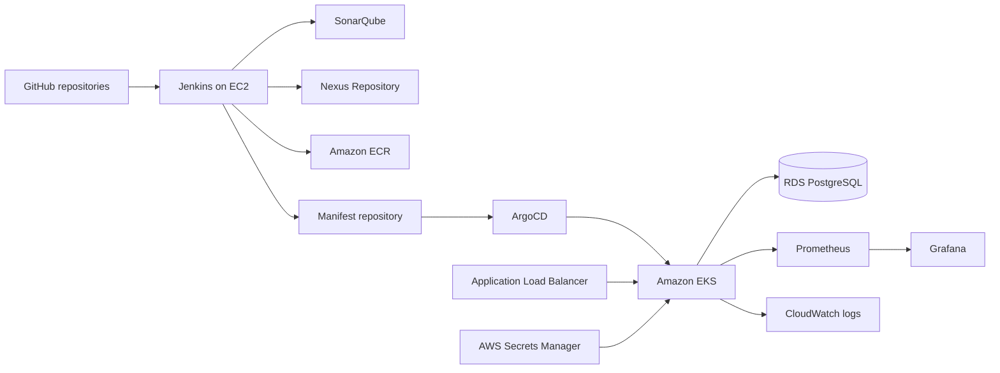

# AWS Production-Like Execution Runbook

## Agreed Decisions

| Item | Decision |
|---|---|
| Region | `us-east-1` |
| Compute | EC2 for Jenkins/administration; EKS for ShopKart workloads |
| Data | Private RDS PostgreSQL |
| Application | Java 21, Spring Boot 3.4, Maven |
| Packages | Nexus Maven proxy plus hosted snapshot/release repositories |
| Images | Private ECR repositories with immutable Git-SHA tags |
| Delivery | Jenkins CI, separate manifest repository, ArgoCD CD |
| Exposure | Internet-facing ALB DNS initially; no custom domain yet |
| Lifetime | Short-lived demonstration followed by `terraform destroy` |
| GitHub | Public repositories under `saikrishna3709` |

This is a production-like development environment. It must not be described as
an actual production system without real users, operational ownership, incident
history, and on-call responsibility. HTTPS also requires a domain and ACM
certificate, so the first ALB-DNS deployment remains HTTP-only.

## Architecture



## GitHub Repository Layout

Create these public repositories:

1. `https://github.com/saikrishna3709-shopkart/shopkart-platform`
   - application services, tests, Dockerfiles, Docker Compose, Terraform, and CI scripts
2. `https://github.com/saikrishna3709-shopkart/shopkart-manifests`
   - Helm chart, environment values, ArgoCD resources, and monitoring manifests
3. `https://github.com/saikrishna3709-shopkart/shopkart-jenkins-library`
   - the shared library with `vars/shopkartPipeline.groovy` at repository root

The manifest repository is separate so a GitOps promotion does not retrigger
application builds. The Jenkins library is separate because Jenkins expects
`vars/` at the configured shared-library repository root.

## Security Rules

- Never paste AWS keys, GitHub tokens, passwords, private keys, kubeconfig, or
  Jenkins secrets into chat or Git.
- Use an EC2 instance profile instead of `aws configure` access keys on EC2.
- Enter the GitHub token directly into Jenkins Credentials or authenticate `gh`
  interactively on EC2.
- Keep the EKS API allowlist restricted to the administration host `/32`; the
  Terraform validation rejects `0.0.0.0/0`.
- Keep RDS and EKS worker nodes in private subnets.
- Use SSM for EC2 administration where possible. Do not expose SSH globally.
- Store application credentials in Secrets Manager and synchronize them through
  External Secrets.

## Mandatory Account Gate

Complete these before the first `terraform apply`:

- Root MFA enabled: complete
- Dedicated provisioning IAM identity: available
- AWS Budget alert: **pending**
- Billing notification email: verify directly in AWS

Recommended budget threshold: `$10`. EKS control-plane, NAT gateway, EC2, and
RDS charges continue while the environment is running.

## Execution Phases

### Phase 1: Finish Cloud Automation

- Add the Jenkins/administration EC2 host, EIP, security group, instance profile,
  encrypted gp3 volume, and installation user data.
- Add IRSA roles and installation automation for AWS Load Balancer Controller
  and External Secrets.
- Install metrics-server and ArgoCD declaratively.
- Replace Nginx-specific ingress annotations with ALB path routing and URL
  transforms.
- Inject the real ECR registry into manifest values without committing an AWS
  account ID manually.

### Phase 2: Publish GitHub Repositories

- Initialize Git history locally or on the administration EC2 host.
- Confirm `.gitignore` excludes `.env`, `.venv`, Terraform state, plans,
  backend configuration, credentials, Maven targets, reports, and generated caches.
- Push the platform, manifest, and shared-library repositories.
- Configure branch protection after the initial import.

### Phase 3: Provision AWS

- Apply the Terraform state bootstrap stack once.
- Initialize the development stack with the encrypted S3 backend and locking.
- Review `terraform plan`; never run an unreviewed auto-approve.
- Apply VPC, EKS `1.36`, six ECR repositories, RDS, IAM, logs, and management
  resources.
- Record outputs without exposing credentials.

### Phase 4: Configure Jenkins CI

- Register the shared library repository.
- Configure Jenkins tools named `temurin-21` and `maven-3.9.11`.
- Create Nexus repositories `maven-releases`, `maven-snapshots`, `maven-central`
  proxy, and the `maven-public` group containing all three.
- Add Jenkins username/password credential `nexus-maven` and global variable
  `NEXUS_URL`; never commit the Nexus password to Maven settings.
- Configure AWS, GitHub, SonarQube, Nexus, Slack, manifest repository, and
  smoke-test settings through Jenkins Credentials and environment configuration.
- Create one multibranch pipeline per service.
- Prove that failed tests, JaCoCo coverage, SonarQube, Nexus publication, and
  HIGH/CRITICAL Trivy findings block image publication.

The shared pipeline performs:

```text
Checkout -> Maven verify -> SonarQube -> quality gate -> Nexus deploy
         -> Docker build -> Trivy -> ECR -> GitOps promotion -> smoke test
```

Nexus stores the service JAR and proxies dependencies through
`ci/maven/settings.xml`; ECR remains the registry for deployable container images.

### Phase 5: Configure GitOps CD

- Install External Secrets and confirm the RDS secret reaches `shopkart-dev`.
- Install ArgoCD and apply the ShopKart AppProject, platform Application, and
  service ApplicationSet.
- Confirm self-heal, pruning, immutable image tags, probes, HPA, PDB, and
  NetworkPolicy behavior.
- Capture the ALB DNS name and set Jenkins `DEV_BASE_URL` to its HTTP URL.

### Phase 6: Production-Like Tests

- Open the storefront, add products to the cart, and execute the complete catalog,
  inventory, checkout, mock payment, and notification flow.
- Repeat an idempotency key and prove no duplicate payment or stock reduction.
- Run load and demonstrate HPA scaling.
- Deploy a bad revision and demonstrate health failure plus rollback.
- Block a dependency with NetworkPolicy and troubleshoot the resulting symptoms.
- Simulate a database outage and prove readiness removes pods without liveness restarts.
- Trigger a vulnerable image and prove Jenkins blocks it.

### Phase 7: Evidence and Destruction

- Capture redacted Jenkins, SonarQube, ArgoCD, Grafana, EKS, ALB, HPA, and
  rollback evidence.
- Save architecture, troubleshooting, cost, and decision records in Git.
- Run `terraform plan -destroy`, review it, then destroy the environment.
- Check the AWS console for retained load balancers, EBS volumes, EIPs, NAT
  gateways, snapshots, and log groups.

## Definition of Done

- All six service pipelines pass, publish JARs to Nexus, and publish immutable
  Git-SHA images to ECR.
- ArgoCD, not Jenkins, changes EKS workloads.
- No credentials or mutable image tags exist in Git or running manifests.
- ALB smoke tests pass for the storefront, catalog, and order routes.
- RDS is private and encrypted; backups are enabled for the demonstration window.
- Alerts fire for service unavailability and application failure conditions.
- Scaling, security-gate failure, drift correction, dependency failure, and
  rollback are demonstrated and documented.
- All short-lived AWS resources are destroyed after evidence is captured.