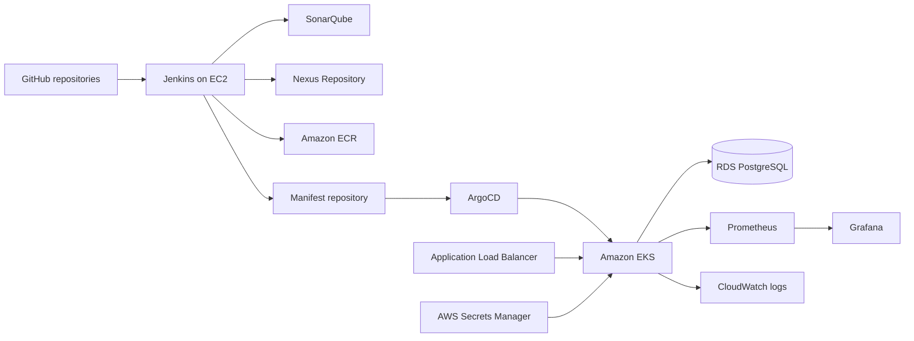

# AWS Production-Like Execution Runbook

## Agreed Decisions

| Item | Decision |
|---|---|
| Region | `us-east-1` |
| Compute | EC2 for Jenkins/administration; EKS for ShopKart workloads |
| Data | Private RDS PostgreSQL |
| Application | Java 21, Spring Boot 3.4, Maven |
| Packages | Nexus Maven proxy plus hosted snapshot/release repositories |
| Images | Private ECR repositories with immutable Git-SHA tags |
| Delivery | Jenkins CI, separate manifest repository, ArgoCD CD |
| Exposure | Internet-facing ALB DNS initially; no custom domain yet |
| Lifetime | Short-lived demonstration followed by `terraform destroy` |
| GitHub | Public repositories under `saikrishna3709-shopkart` |

This is a production-like development environment. It must not be described as
an actual production system without real users, operational ownership, incident
history, and on-call responsibility. HTTPS also requires a domain and ACM
certificate, so the first ALB-DNS deployment remains HTTP-only.

## Local Demo

The application demo runs without Docker or an AWS account. It uses the same
built Java services with isolated H2 databases; it does not demonstrate EKS,
RDS, Jenkins, or ArgoCD running locally. Payments and notifications are mocks.
Use only synthetic customer details. Authentication and real payment collection
are outside this demo's scope; keep it on loopback unless using the reviewed AWS lab.

### Start and Verify

From `shopkart-platform` in Windows PowerShell:

```powershell
.\ci\scripts\demo.ps1 -Action start
```

Java 21 and Maven are required. The script uses whatever is on `PATH`, falling
back to `JAVA_HOME` for Java. Custom installations can
be passed with `-Java` and `-Maven`. It builds all six services with their existing
test and coverage gates before launching them. `-SkipBuild` reuses already
verified JARs; do not use it after editing service code.

The storefront is `http://localhost:8088`. Backend ports are 18001 (catalog),
18002 (inventory), 18003 (payment), 18004 (orders), and 18005 (notifications).
Use `-Port` and `-ServicePortBase` if these ports are occupied. The script refuses
to stop unrelated processes or replace an existing managed demo.

```powershell
.\ci\scripts\demo.ps1 -Action status
.\ci\scripts\demo.ps1 -Action test
```

The smoke suite first checks all six revision endpoints and requires the
requested service to report the expected revision. It then verifies the catalog,
order query, storefront page, confirmed checkout with an idempotent replay, and
a declined mock payment. Reports are in `tests/smoke/target/surefire-reports`.
Logs and persistent local databases are in the Git-ignored `.demo` directory.
Each successful smoke run consumes one stock unit; failures must not be ignored.

### Presentation Walkthrough

1. Open the storefront, search for a product, and switch a category.
2. Add a product, change its quantity, and reload to show the cart persists.
3. Check out with `demo@example.test`; show the confirmed order and empty cart.
4. Run `-Action test` to demonstrate the successful, replay, and decline checks.
5. Open `/api/deployments/order-service` to explain how CI checks a deployed
  revision instead of accepting a generic HTTP 200 response.
6. Show the three repository boundaries and trace one Jenkinsfile into the shared
  pipeline, image-tag promotion, and ArgoCD ApplicationSet.
7. Show the tested coverage and deployment configurations. Present scaling,
  rollback, and monitoring as live evidence only after the AWS phases below.

To validate delivery configuration without a cluster, keep the three repositories
as siblings, install Helm, and run:

```powershell
.\ci\scripts\demo.ps1 -Action validate
```

This renders the ApplicationSet expressions and all service releases, parses
Groovy syntax, and verifies the pinned monitoring chart's generated Alertmanager
configuration. It may download the Helm chart; it does not create AWS resources.

When finished:

```powershell
.\ci\scripts\demo.ps1 -Action stop
```

Data survives a stop/start. To reset this isolated demo, stop it first, remove
only `.demo/data`, then start again; this deletes its test orders and restores
seeded stock. Do not delete live RDS or PostgreSQL data to reset a presentation.

## Architecture



## GitHub Repository Layout

Create these public repositories:

1. `https://github.com/saikrishna3709-shopkart/shopkart-platform`
   - application services, tests, Dockerfiles, Docker Compose, Terraform, and CI scripts
2. `https://github.com/saikrishna3709-shopkart/shopkart-manifests`
   - Helm chart, environment values, ArgoCD resources, and monitoring manifests
3. `https://github.com/saikrishna3709-shopkart/shopkart-jenkins-library`
   - the shared library with `vars/shopkartPipeline.groovy` at repository root

The manifest repository is separate so a GitOps promotion does not retrigger
application builds. The Jenkins library is separate because Jenkins expects
`vars/` at the configured shared-library repository root.

## Security Rules

- Never paste AWS keys, GitHub tokens, passwords, private keys, kubeconfig, or
  Jenkins secrets into chat or Git.
- Use an EC2 instance profile instead of `aws configure` access keys on EC2.
- Enter the GitHub token directly into Jenkins Credentials or authenticate `gh`
  interactively on EC2.
- Keep the EKS API allowlist restricted to the administration host `/32`; the
  Terraform validation rejects `0.0.0.0/0`.
- Keep RDS and EKS worker nodes in private subnets.
- Use SSM for EC2 administration where possible. Do not expose SSH globally.
- Store application credentials in Secrets Manager and synchronize them through
  External Secrets.

## Mandatory Account Gate

Complete these before the first `terraform apply`:

- Root MFA enabled: complete
- Dedicated provisioning IAM identity: must be used for CLI and Terraform
- AWS CLI browser login as root: forbidden
- AWS Budget alert: declined by the account owner on 2026-10-17
- Billing notification email: verify directly in AWS

Skipping the budget removes an important warning mechanism; it does not cap
charges. EKS control-plane, NAT gateway, EC2, and RDS charges continue while the
environment is running. Every apply still requires an explicit reviewed plan,
and the environment must be destroyed after the demonstration.

New AWS accounts can start on the Free Plan with credits and restricted service
access. If EKS is unavailable, upgrade to the Paid Plan only immediately before
the approved apply. AWS states that remaining Free Tier credits continue to
cover eligible usage after the upgrade until they expire.

## Execution Phases

### Phase 1: Cloud Automation

Implemented and locally validated:

- Jenkins/administration EC2 host with EIP, restricted security group, SSM,
  IMDSv2, encrypted gp3 storage, and an instance profile.
- Jenkins RPM installation plus a persistent Docker Compose stack for pinned
  SonarQube, Nexus, and PostgreSQL images. The SonarQube database password is
  generated on the instance and never enters Terraform state.
- Trivy from its signed RPM repository and AWS CLI availability checks.
- IRSA roles and pinned Helm releases for AWS Load Balancer Controller and
  External Secrets, plus Metrics Server and ArgoCD.
- ALB ingress sends the public website and API proxy routes to the storefront.
- Jenkins promotion writes both the real ECR repository and immutable Git-SHA
  tag into the GitOps repository.
- AWS VPC CNI network-policy enforcement and EKS access entries for the
  administration role.

Live AWS validation remains pending.

### Phase 2: Publish GitHub Repositories

- Initialize Git history locally or on the administration EC2 host.
- Confirm `.gitignore` excludes `.env`, `.venv`, Terraform state, plans,
  backend configuration, credentials, Maven targets, reports, and generated caches.
- Push the platform, manifest, and shared-library repositories.
- Configure branch protection after the initial import.

### Phase 3: Provision AWS

- Authenticate with `aws login` while signed into a non-root provisioning IAM
  identity, then verify `aws sts get-caller-identity` does not end in `:root`.
- Install the Session Manager plugin from the official AWS Windows installer;
  it requires a local Administrator prompt.
- Apply the Terraform state bootstrap stack once.
- Initialize the development stack with the encrypted S3 backend and locking.
- Review `terraform plan`; never run an unreviewed auto-approve.
- Apply VPC, EKS `1.36`, six ECR repositories, RDS, IAM, logs, and management
  resources.
- Record outputs without exposing credentials.

### Phase 4: Configure Jenkins CI

- Register the shared library repository.
- Configure Jenkins tools named `temurin-21` and `maven-3.9.11`.
- Register a build agent labelled `docker` and keep controller executors at zero.
- Verify Docker, Git, AWS CLI, and Trivy on that agent. Set a Nexus URL that the
  agent can resolve, and configure SonarQube's `/sonarqube-webhook/` callback.
- Create Nexus repositories `maven-releases`, `maven-snapshots`, `maven-central`
  proxy, and the `maven-public` group containing all three.
- Add Jenkins username/password credential `nexus-maven` and global variable
  `NEXUS_URL`; never commit the Nexus password to Maven settings.
- Use the agent's EC2 IAM role for AWS. Configure GitHub, SonarQube, Nexus,
  `ECR_REGISTRY`, `MANIFEST_REPO`, and `DEV_BASE_URL` in Jenkins. Slack is optional;
  leave `SLACK_CHANNEL` unset until its integration is configured.
- Create one multibranch pipeline per service.
- Prove that failed tests, JaCoCo coverage, SonarQube, Nexus publication, and
  fixable HIGH/CRITICAL Trivy findings block image publication (`--ignore-unfixed`).

The shared pipeline performs:

```text
Checkout -> Maven verify -> SonarQube -> quality gate -> Nexus deploy
         -> Docker build -> Trivy -> ECR -> GitOps promotion -> smoke test
```

Nexus stores the service JAR and proxies dependencies through
`ci/maven/settings.xml`; ECR remains the registry for deployable container images.
Reruns pull and rescan a previously published immutable image rather than trying
to overwrite its tag. The smoke report is retained in Jenkins before cleanup.

### Phase 5: Configure GitOps CD

- Install External Secrets and confirm the RDS secret reaches `shopkart-dev`.
- Install ArgoCD and apply the ShopKart AppProject, platform Application, and
  service ApplicationSet.
- Confirm self-heal, pruning, immutable image tags, probes, HPA, PDB, and
  NetworkPolicy behavior.
- Capture the ALB DNS name and set Jenkins `DEV_BASE_URL` to its HTTP URL.
- Start all six service pipelines for the first deployment. Their placeholder
  images cannot start before publication. Rerun any smoke stage that timed out
  while waiting for the other services; published ECR images are reused.
- Install `kube-prometheus-stack` version `82.2.0` using the manifest repository's
  monitoring values, then apply its ServiceMonitor, alerts, and dashboard as
  described in that repository's README. This is a separate administration step.
- Monitoring uses ephemeral storage for this short-lived lab. Grafana's chart
  generates a password Secret; obtain it directly in your own terminal. Alerts
  are visible in Alertmanager without Slack or PagerDuty credentials.

### Phase 6: Production-Like Tests

- Open the storefront, add products to the cart, and execute the complete catalog,
  inventory, checkout, mock payment, and notification flow.
- Repeat an idempotency key and prove no duplicate payment or stock reduction.
- Run load and demonstrate HPA scaling.
- Deploy a bad revision and demonstrate health failure plus rollback.
- Block a dependency with NetworkPolicy and troubleshoot the resulting symptoms.
- Simulate a database outage and prove readiness removes pods without liveness restarts.
- Trigger a vulnerable image and prove Jenkins blocks it.

### Phase 7: Evidence and Destruction

- Capture redacted Jenkins, SonarQube, ArgoCD, Grafana, EKS, ALB, HPA, and
  rollback evidence.
- Save architecture, troubleshooting, cost, and decision records in Git.
- Run `terraform plan -destroy`, review it, then destroy the environment.
- Check the AWS console for retained load balancers, EBS volumes, EIPs, NAT
  gateways, snapshots, and log groups.

## Definition of Done

- All six service pipelines pass, publish JARs to Nexus, and publish immutable
  Git-SHA images to ECR.
- ArgoCD, not Jenkins, changes EKS workloads.
- No credentials or mutable image tags exist in Git or running manifests.
- ALB smoke tests pass for the storefront, catalog, and order routes.
- RDS is private and encrypted; backups are enabled for the demonstration window.
- Alerts fire for service unavailability and application failure conditions.
- Scaling, security-gate failure, drift correction, dependency failure, and
  rollback are demonstrated and documented.
- All short-lived AWS resources are destroyed after evidence is captured.

## Local Validation Baseline

- 110 Java service tests pass with all six JaCoCo gates.
- Five live smoke checks pass on the isolated local demo; an incorrect expected
  revision is rejected. These are not evidence of a completed EKS rollout.
- Four delivery configuration tests pass, including ApplicationSet expression
  rendering and the generated Alertmanager routing.
- Terraform formatting and validation pass with the Jenkins and add-on modules.
- All six Helm releases lint and render; 35 standard Kubernetes resources pass
  strict schema checks. Five ExternalSecret resources need their CRD schema and
  are skipped by the local schema command.
- The pinned monitoring stack renders; 73 standard resources pass schema checks.
  Fifty operator custom resources are skipped by the local schema command.
- ALB ingress and platform Kubernetes resources pass schema validation.
- The Jenkins promotion script passes Bash syntax validation.
- The EC2 bootstrap passes Bash syntax validation; installation and the complete
  Jenkins pipeline still require a live AWS run.